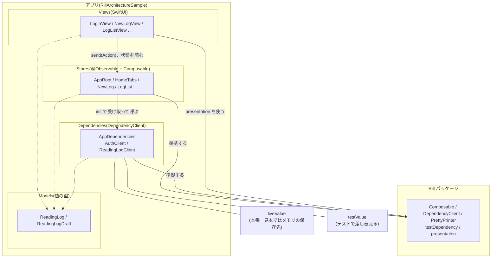
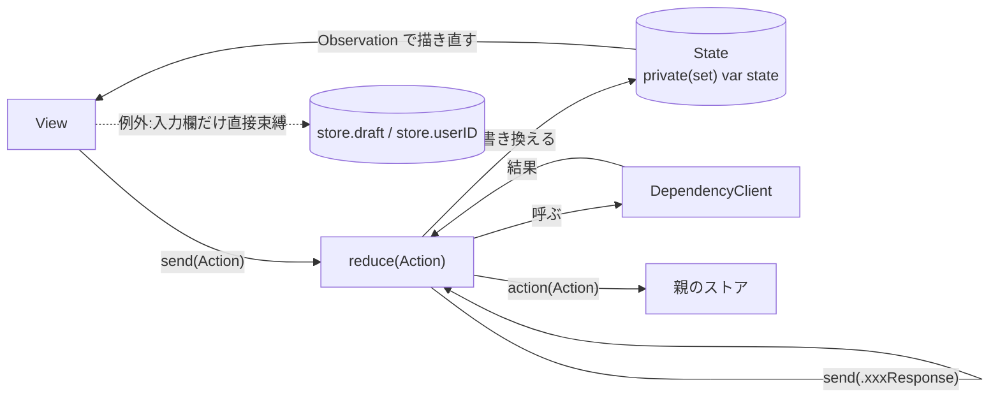
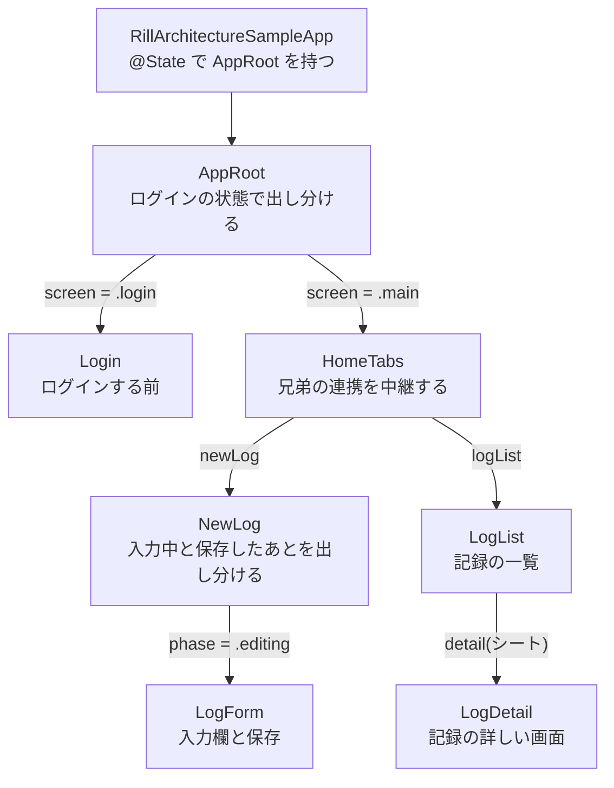
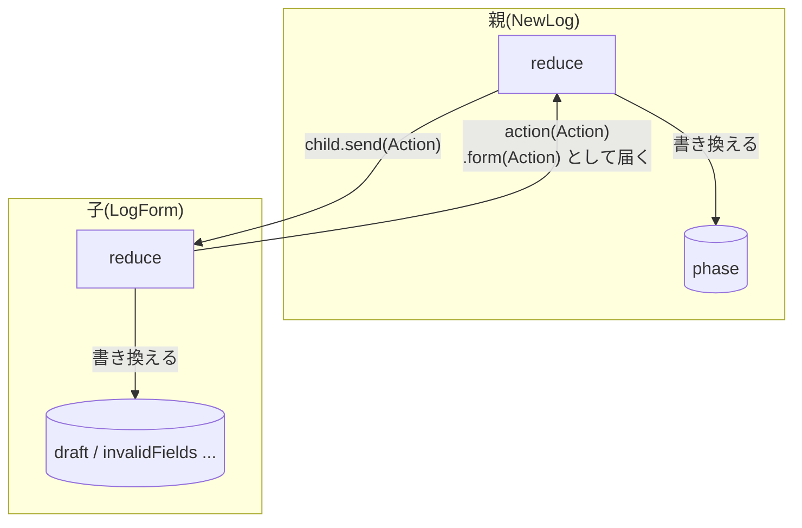
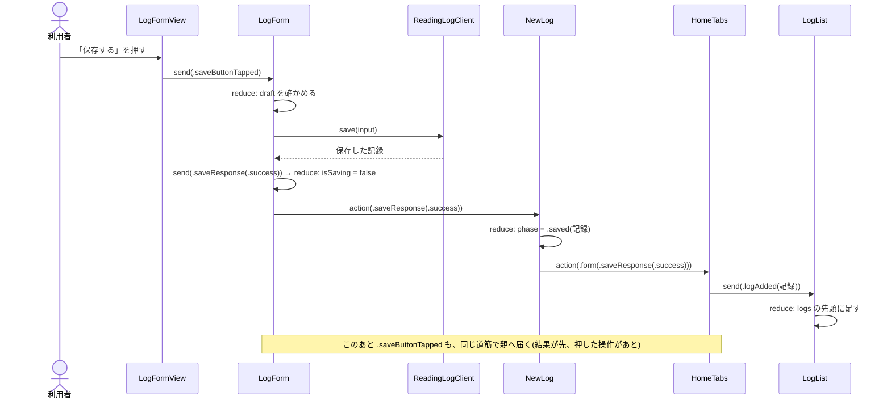
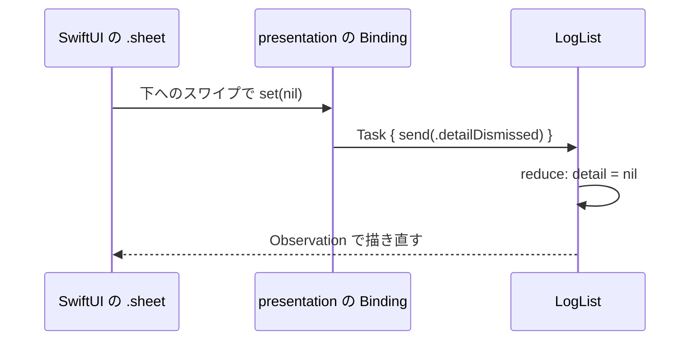
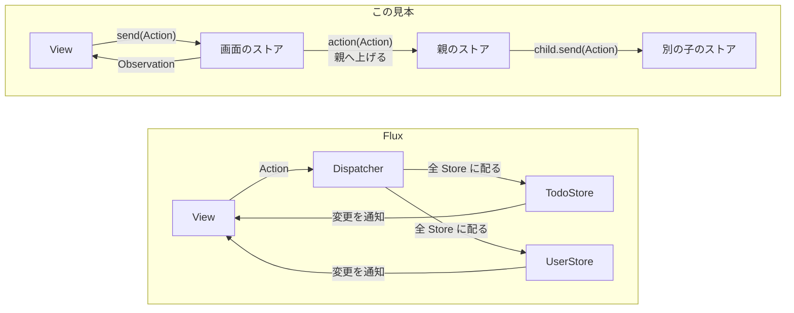

# RillArchitectureSample

<p align="center">

</p>

SwiftUI のアプリのアーキテクチャ **Rill** の見本。

Rill は、[LUCA](https://dev.to/kyome22/luca-a-modern-architecture-for-swiftui-development-3g2i) から着想を得ており、
LUCAのうち `Composable` だけを抜き出し、決まりを 4 つ足した構成。次の 4 つを満たせることを確かめる。

- 状態管理がアーキテクチャとして組み込まれている
- テストしやすい
- 単一方向である
- View 同士の連携(親子間も含む)がしやすい

題材は、読んだ本を記録する小さなアプリ(ログイン、記録する、一覧、詳しい画面)。

名前の Rill は「小さな流れ」のこと。状態が一方向に流れることと、中心が小さい(20 行ほどのプロトコル)ことから。

## 動かし方

```sh
make generate              # project.yml から RillArchitectureSample.xcodeproj を作る(XcodeGen は mint で入れる)
make test                  # アプリのストアと Rill パッケージのテスト(Swift Testing、シミュレーター)
make test-rill             # Rill パッケージのテストだけ(swift test、macOS で手早く)
make check-unidirectional  # 単一方向を破る書き方が、コンパイルエラーになることを確かめる
make check                 # 上の 2 つ
```

`RillArchitectureSample.xcodeproj` を開いて実行すると、ログイン → 記録する → 一覧を触れる。
保存先はメモリの中だけなので、アプリを終えると記録は消える。ユーザー ID に `error` と入れるとログインに失敗する。

動作の確認は Xcode 27.1、iOS 26 のシミュレーターで行った。

## 構造の図

### 層と依存の向き

矢印は「使う」向き。View はストアだけを、ストアは依存だけを知る。
ストアと依存の決まり(`Composable`、`DependencyClient`)は、アプリから切り離した `Rill` パッケージに置く。
パッケージはアプリの型を知らない。



### 1 つの画面の中の流れ(単一方向)

状態を書き換えられるのは `reduce` だけ。View は Action を送り、状態の変化を Observation で受け取って描き直す。



### 画面とストアの木

実線は「親が子のストアを持つ」。子の Action は `action` のクロージャで親の `reduce` に届き、親は子へ `send` で指示する。



### 親子の間のやり取り

上へは `action` のクロージャ、下へは `send`。どちらも Action で、相手の状態には触らない。



子を作るときに、親が `action` を渡す。

```swift
LogForm(appDependencies, action: { [weak self] in await self?.send(.form($0)) })
```

### 兄弟の連携:記録を保存すると一覧に足される

記録する画面(孫)の結果が、親の `HomeTabs` で中継されて、一覧の画面(兄弟)へ届く。



### シートを閉じる:スワイプでも Action を通す



「閉じる」ボタンのときは、子(`LogDetail`)が `send(.closeButtonTapped)` し、親の `LogList` が `.detail(.closeButtonTapped)` として受けて `detail = nil` にする。

## ファイル

| ディレクトリ | 中身 |
|---|---|
| `Packages/Rill/Sources/Rill` | `Composable`(LUCA をもとに `State` を足したもの)、`DependencyClient`、`PrettyPrinter`、シートの Binding の補助 |
| `Packages/Rill/Tests/RillTests` | パッケージのテスト |
| `RillArchitectureSample/Dependencies` | `AppDependencies`、`AuthClient`、`ReadingLogClient` |
| `RillArchitectureSample/Models` | 読書の記録と、入力の確かめ |
| `RillArchitectureSample/Stores` | 画面ごとのストア |
| `RillArchitectureSample/Views` | 画面ごとの View |
| `RillArchitectureSampleTests` | ストアのテスト |
| `Checks` | 単一方向の確かめ |

## 4 つの条件をどこで確かめるか

### 1. 状態管理がアーキテクチャとして組み込まれている

- 画面の状態は、すべてストア(`Stores/`)の `State` の構造体にまとめ、`private(set) var state` で持つ。
  View は状態を持たない(`@State` はアプリの一番上の `AppRoot` だけ)。
- `Composable` が `State` と `state` を要件にしているので、どのストアも同じ形になる(`Packages/Rill/Sources/Rill/Composable.swift`)。
- 状態を変える入口は `send(Action)` の 1 つだけ。
- 遷移も状態として持つ。`AppRoot.State.screen`、`NewLog.State.phase`、`LogList.State.detail` に子のストアを入れれば出て、外せば消える。

```swift
@Observable
final class LogList: Composable {

    struct State {
        var logs: [ReadingLog] = []
        var detail: LogDetail?
        var loadFailed = false
    }

    private(set) var state: State
    ...
}
```

#### 状態を見る(pretty print)

`store.prettyState` で、状態を字下げした文字列にできる。`store.printState()` はそれをコンソールに出す。
LLDB では `po store.prettyState` で見られる。

子のストアは、その `State` を入れ子で並べるので、一番上の `AppRoot` から出すとアプリ全体の状態が 1 つの木で見える。
集合と辞書は並べ替えて出すので、何度出しても同じ文字列になる(テストで丸ごと比べられる)。

```
AppRoot.State(
  screen: .main(
    HomeTabs.State(
      newLog: NewLog.State(
        phase: .saved(
          ReadingLog(
            id: 00000000-0000-0000-0000-000000000001,
            title: "見本の本",
            pages: 120,
            rating: nil,
            loggedAt: 0001-01-01 00:00:00 +0000
          )
        )
      ),
      logList: LogList.State(
        logs: [
          ReadingLog(...)
        ],
        detail: nil,
        loadFailed: false
      )
    )
  )
)
```

`print(store.state)` や `po store.state` の既定の出力(`CustomDebugStringConvertible`)を差し替える形にはしていない。
`debugDescription` は隔離されない要件なので、MainActor のストアの状態を読む実装と相性が悪いため。

### 2. テストしやすい

`make test` で 47 件(アプリのストア 22 件、Rill パッケージ 25 件)。
どれも View を立ち上げず、ストアを作って `await send(...)` し、状態を確かめるだけ。

アプリのストアのテスト(`RillArchitectureSampleTests`):

| テスト | 確かめること |
|---|---|
| `LogFormTests` | 1 つのストア。依存の差し替え(`testDependency(of:)`)、親へ届いた Action |
| `NewLogTests` | 親子。子へ `send` すると、親の状態が変わる |
| `HomeTabsTests` | 兄弟。記録する画面で保存すると、親が中継して一覧に足される |
| `LogListTests` | シートの子。子の「閉じる」「削除」で、親が閉じる |
| `AppRootTests` | ログイン → 記録 → 一覧 → ログアウトを、Action だけで通す。アプリ全体の状態を `prettyState` で丸ごと比べる |

Rill パッケージのテスト(`RillTests`)。アプリの型を使わず、テスト用の小さなストアで決まりそのものを確かめる:

| テスト | 確かめること |
|---|---|
| `ComposableTests` | `send` は `reduce` で状態を確定してから親へ伝える。`reduce` の中で待つ処理も終わりまで待つ。`reduce` の中から `send` すると結果が先に親へ届く。`reduce` を書かないストアは親へそのまま伝える |
| `PresentationTests` | `presentation` の Binding は子のストアを返す。`nil` を入れると dismiss の Action を送って閉じる。`nil` 以外を入れても何も送らない |
| `DependencyClientTests` | `testDependency` は差し替えた所だけを変え、`testValue` そのものは変えない |
| `PrettyPrinterTests` | 文字、数、`Optional`、構造体、列挙型(関連値つき)、配列、集合、辞書、入れ子のストアを、決まった形で字下げして出す |

`send` の順番を逆にすると、`ComposableTests` と `PresentationTests` の 5 件が落ちることを確かめてある。

`send` は `reduce` の終わりまで待つので、待ち合わせのコードは要らない。

### 3. 単一方向である

`make check-unidirectional` で確かめる。`Checks/UnidirectionalViolations.swift` の、外から状態を書き換える 9 行が、
すべて `setter is inaccessible` のコンパイルエラーになる。

決まり:

1. ストアの状態は `State` にまとめ、`private(set) var state` で持つ。`store.state.xxx = ...` は、そのストアの外からは書けない。
2. 例外は入力欄の値だけ。`TextField` は同期で書き換える必要があるため。
   `state` の中の値を、書き込みのできる計算プロパティ(`Login.userID`、`LogForm.draft`)として 1 つずつ出し、`$store.draft` で束縛する。
   `$store.state.draft` では束縛できない。値を使う判断(確かめる、保存する)は `send(.saveButtonTapped)` の中で行う。
3. 親から子への指示も `await child.send(...)` で行う(`HomeTabs` が `logList.send(.logAdded(...))` を呼ぶ)。
4. `reduce` の中で `Task { }` を作らない。

シートは `$store.state.detail` で束縛できない(決まり 1)。代わりに `store.presentation(\.state.detail, dismiss: .detailDismissed)`
(`Packages/Rill/Sources/Rill/Composable+Presentation.swift`)を使い、スワイプで閉じたときも Action を通す。

### 4. View 同士の連携がしやすい

| 連携 | 見本の場所 |
|---|---|
| 子から親 | `LogForm` の `saveResponse` → `NewLog.reduce` の `.form(.saveResponse(.success))` |
| 親から子 | `HomeTabs.reduce` が `logList.send(.logAdded(...))` |
| 兄弟の間 | 記録する画面(孫)で保存 → `HomeTabs` が受けて → 一覧へ送る |
| 子を出す、閉じる | `LogList.State.detail`(シート)。子の「閉じる」「削除」は親が受けて `nil` にする |
| 画面の切り替え | `AppRoot.State.screen`(ログイン ↔ タブ)、`NewLog.State.phase`(入力中 ↔ 保存したあと) |

## Flux との違い

Flux と同じく、状態は一方向に流れる。状態を変えるのは Action だけで、書き換えられるのは Store だけ、View は読むだけ。
違いは、Action の届け方と、Store の単位にある。



| | Flux | この見本 |
|---|---|---|
| Action の届け方 | Dispatcher が、すべての Store に配る | View が自分の画面のストアに `send` する。親へは `action` のクロージャで上げる |
| Store の単位 | 扱うデータごと(`TodoStore` など)。画面からは独立していて、アプリに数個 | 画面ごと。親が子を持つ木になる |
| Store 同士の連携 | 同じ Action を、それぞれの Store が受け取る。順番は `waitFor` で決める | 共通の親が子の Action を受け取り、別の子へ `send` する |
| 副作用(通信など) | Action Creator で行い、結果を別の Action として配る | `reduce` の中で依存を呼び、結果を `send(.xxxResponse)` で自分に送る |
| View への反映 | Store の変更の通知を購読する | Observation が、読んだ値を自動で追う |
| 状態の寿命 | Store はアプリと同じだけ生きることが多い | 画面のストアと同じ。画面を閉じれば消える |
| 得意なこと | 複数の画面が同じデータを見る(共有の状態) | 画面ごとに閉じた状態と、親子の連携。テストもストアごとに閉じる |
| 苦手なこと | どの Store がどの Action に反応するか、追いにくくなる | 離れた画面どうしの共有。共通の親まで Action を中継する必要がある |

### Flux の考え方を足すなら

離れた画面どうしで同じデータを見る場面が増えたら、データごとの Store(Flux の Store に近いもの)を 1 つ足し、
`AppDependencies` に入れて各画面のストアへ渡す形が合う。LUCA の `AppStateClient` も同じ考え方。
画面のストアは、その Store を読み書きする「入口」になる。

## UIKit で使う

使える。ストア、依存、テストは UI の仕組みに依存しないので、そのまま使える。変わるのは View の層だけ。
(`Rill` パッケージで SwiftUI を使っているのは、シートの Binding の補助の `presentation` だけ。)

見本には UIKit の画面を含めていない。下のコードは、アプリのソースと一緒に型検査が通ることだけを確かめた概要で、動かしてはいない。

### SwiftUI との対応

| すること | SwiftUI | UIKit |
|---|---|---|
| 状態を読んで描く | `body` で `store.state` を読む | `updateProperties()` で `store.state` を読む。iOS 26 の UIKit は、そこで読んだ Observable の値を追い、変わると呼び直す |
| 操作を送る | `Button { Task { await store.send(...) } }` | `UIAction { _ in Task { await store.send(...) } }` |
| 入力欄(例外) | `$store.draft.title` で束縛する | `.editingChanged` で `store.draft.title = text` を同期で書く |
| 子の画面 | 子の View に子のストアを渡す | 子の ViewController に子のストアを渡す |
| シート | `.sheet(item: store.presentation(\.state.detail, dismiss: .detailDismissed))` | `updateProperties()` で `state.detail` を見て `present` / `dismiss` する。スワイプで閉じたら `presentationControllerDidDismiss` で `.detailDismissed` を送る |
| タブ、画面の切り替え | `TabView`、`switch store.state.screen` | `UITabBarController`。`AppRoot.state.screen` を見て `rootViewController` を差し替える |

### 書き方の例

```swift
final class LogFormViewController: UIViewController {

    private let store: LogForm
    private let titleField = UITextField()
    private let saveButton = UIButton(configuration: .filled())
    private let errorLabel = UILabel()

    // init(store:) は省略

    override func viewDidLoad() {
        super.viewDidLoad()
        // 入力欄の値だけは、例外として同期で書き込む。
        titleField.addAction(UIAction { [unowned self] _ in
            store.draft.title = titleField.text ?? ""
        }, for: .editingChanged)
        // 操作は Action として送る。
        saveButton.addAction(UIAction { [unowned self] _ in
            Task { await store.send(.saveButtonTapped) }
        }, for: .primaryActionTriggered)
    }

    // iOS 26 の UIKit は、ここで読んだ Observable の値を追い、変わると呼び直す。
    override func updateProperties() {
        super.updateProperties()
        saveButton.isEnabled = !store.state.isSaving
        errorLabel.isHidden = store.state.invalidFields.isEmpty
    }
}

final class LogListViewController: UIViewController, UIAdaptivePresentationControllerDelegate {

    private let store: LogList

    // init(store:) は省略

    override func updateProperties() {
        super.updateProperties()
        // 子のストアがあればシートを出し、無ければ閉じる。
        switch (store.state.detail, presentedViewController) {
        case let (detail?, nil):
            let sheet = UINavigationController(rootViewController: LogDetailViewController(store: detail))
            sheet.presentationController?.delegate = self
            present(sheet, animated: true)
        case (nil, .some):
            dismiss(animated: true)
        default:
            break
        }
    }

    // 下へのスワイプで閉じたときも、状態を直接 nil にせず Action を送る。
    func presentationControllerDidDismiss(_ presentationController: UIPresentationController) {
        Task { await store.send(.detailDismissed) }
    }
}
```

### 気をつけること

- **状態から画面を出し入れする所は、自分で差分を見る。** SwiftUI は `state.detail` を渡せば出し入れまでしてくれるが、
  UIKit では「今の状態」と「今出ている画面」を比べて `present` / `dismiss` / `push` / `pop` を呼ぶ必要がある。UIKit で一番手間がかかる所。
- **iOS 26 より前で使うとき。** iOS 18 では Info.plist に `UIObservationTrackingEnabled` を `YES` で足すと、
  `viewWillLayoutSubviews()` などで読んだ値が追われる(`updateProperties()` は iOS 26 から)。
  iOS 17 では `withObservationTracking` で自分で購読し直す必要がある。
- **`presentation` は SwiftUI 専用。** UIKit だけのアプリで使うなら、`presentation` を `Rill` から
  別のターゲット(例:`RillSwiftUI`)へ分けると、`Rill` が SwiftUI に依存しなくなる。
- **テストは変わらない。** ストアのテストは View を立ち上げないので、UIKit でも SwiftUI でも同じものが使える。
  SwiftUI と UIKit の画面を混ぜても、同じストアを渡せばよい。

## LUCA との違い

- LUCA の 3 つのモジュール(UserInterface、Model、DataSource)への分割、`Scene` の層、`AppStateClient` は入れていない(この見本の規模では要らない)。
  切り出したのは、どのアプリでも使える決まり(`Composable`、`DependencyClient`)の `Rill` パッケージだけ。
- 状態を 1 つの `State` の構造体にまとめる(LUCA は、ストアの中にふつうの `var` で並べる)。
  `Composable` の要件にしたので、どのストアでも `state` で読み、`prettyState` で出せる。
- 依存は Environment で配らず、ストアの init で受け取って子へ渡す。
- 子のストアを init の中で作るときは、`weak var parent` を先に捕まえ、最後に `self` を入れる
  (init が終わるまで `[weak self]` を使えないため)。
- モジュールの既定の隔離を MainActor にしたので、`@MainActor` を書かない。

## 気づいたこと

- 子の `reduce` の中から `send` すると、親には「結果」の Action が先に、「押した」の Action があとに届く
  (`LogFormTests` の最初のテストで確かめている)。親は「押した」ではなく「結果」で判断する。
- シートを下へのスワイプで閉じたとき、`presentation` は `Task` で Action を送るので、状態が `nil` になるのは一瞬あとになる。
  シミュレーターでの見た目はまだ確かめていない。

## 参考

- [LUCA: A Modern Architecture for SwiftUI Development](https://dev.to/kyome22/luca-a-modern-architecture-for-swiftui-development-3g2i)
- [Kyome22/Telescopure の `Composable.swift`](https://github.com/Kyome22/Telescopure/blob/main/LocalPackage/Sources/Model/Composable.swift)
- [Updating views automatically with observation tracking in UIKit(Apple)](https://developer.apple.com/documentation/uikit/updating-views-automatically-with-observation-tracking-in-uikit)
