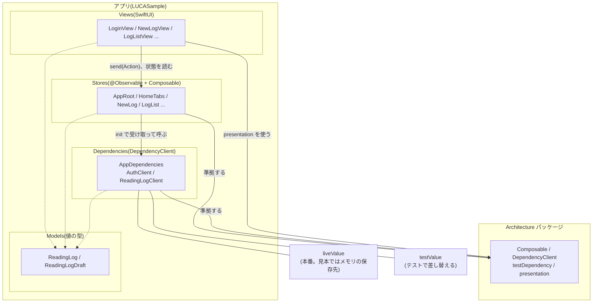
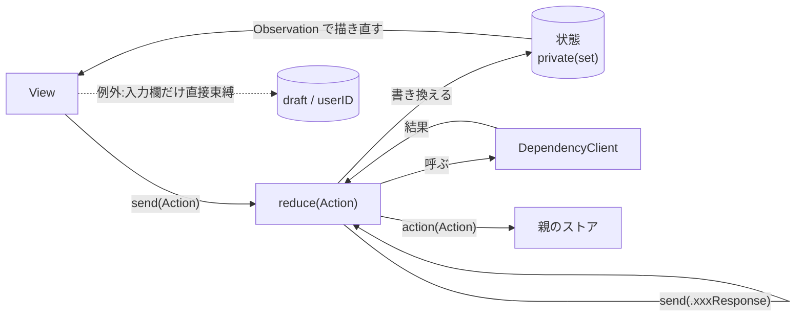
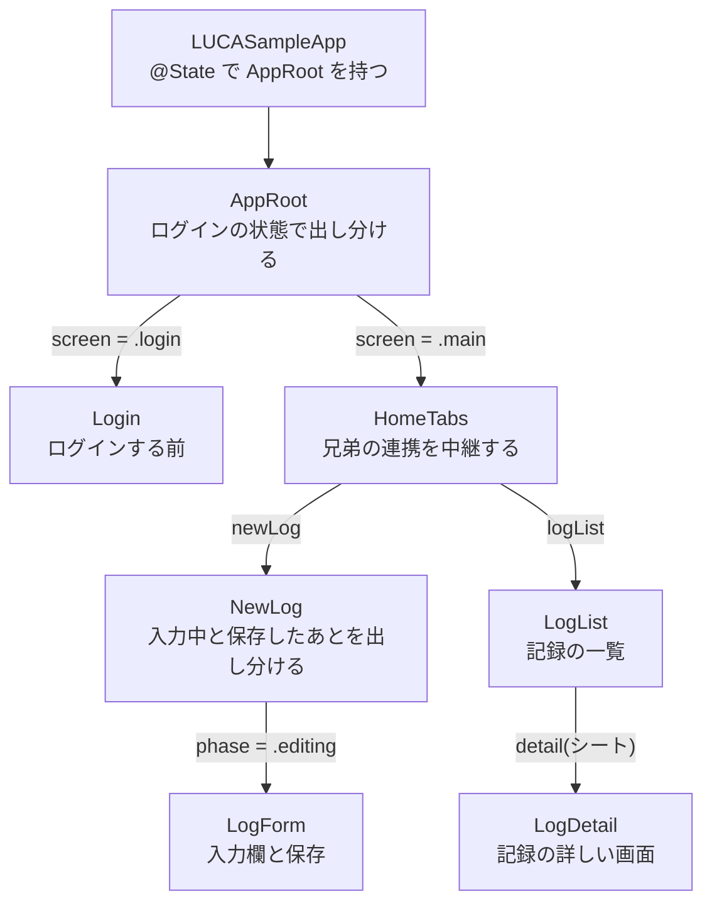
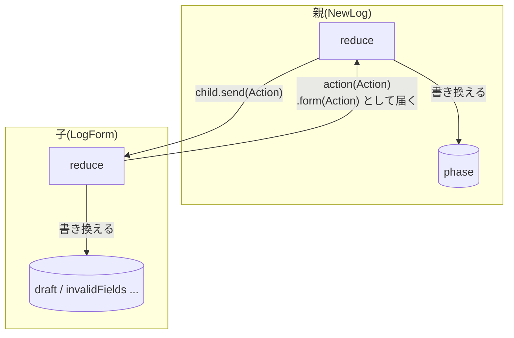
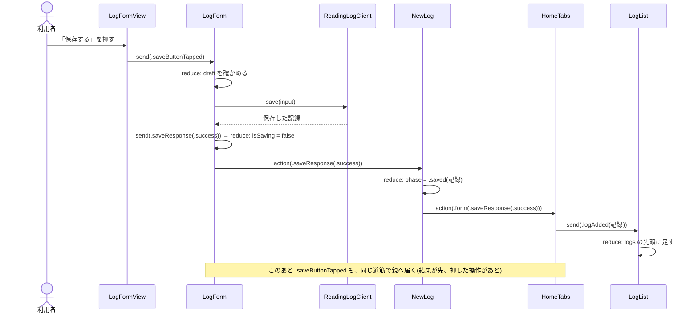
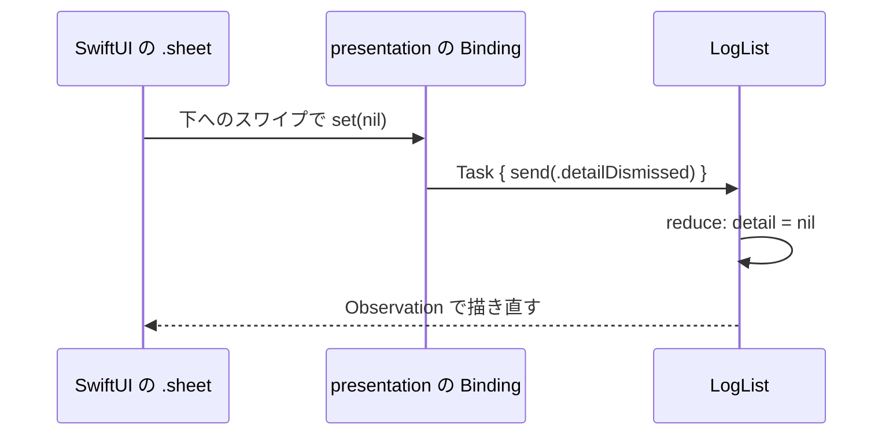

# LUCA-extracted architecture sample

SwiftUI のアプリのアーキテクチャを選ぶための見本。[LUCA](https://dev.to/kyome22/luca-a-modern-architecture-for-swiftui-development-3g2i) の `Composable` だけを取り入れ、
決まりを 4 つ足した構成で、次の 4 つを満たせることを確かめる。

- 状態管理がアーキテクチャとして組み込まれている
- テストしやすい
- 単一方向である
- View 同士の連携(親子間も含む)がしやすい

題材は、読んだ本を記録する小さなアプリ(ログイン、記録する、一覧、詳しい画面)。

## 動かし方

```sh
make generate              # project.yml から LUCASample.xcodeproj を作る(XcodeGen は mint で入れる)
make test                  # アプリのストアと Architecture パッケージのテスト(Swift Testing、シミュレーター)
make test-architecture     # Architecture パッケージのテストだけ(swift test、macOS で手早く)
make check-unidirectional  # 単一方向を破る書き方が、コンパイルエラーになることを確かめる
make check                 # 上の 2 つ
```

`LUCASample.xcodeproj` を開いて実行すると、ログイン → 記録する → 一覧を触れる。
保存先はメモリの中だけなので、アプリを終えると記録は消える。ユーザー ID に `error` と入れるとログインに失敗する。

動作の確認は Xcode 27.1、iOS 26 のシミュレーターで行った。

## 構造の図

### 層と依存の向き

矢印は「使う」向き。View はストアだけを、ストアは依存だけを知る。
ストアと依存の決まり(`Composable`、`DependencyClient`)は、アプリから切り離した `Architecture` パッケージに置く。
パッケージはアプリの型を知らない。



### 1 つの画面の中の流れ(単一方向)

状態を書き換えられるのは `reduce` だけ。View は Action を送り、状態の変化を Observation で受け取って描き直す。



### 画面とストアの木

実線は「親が子のストアを持つ」。子の Action は `action` のクロージャで親の `reduce` に届き、親は子へ `send` で指示する。



### 親子の間のやり取り

上へは `action` のクロージャ、下へは `send`。どちらも Action で、相手の状態には触らない。



子を作るときに、親が `action` を渡す。

```swift
LogForm(appDependencies, action: { [weak self] in await self?.send(.form($0)) })
```

### 兄弟の連携:記録を保存すると一覧に足される

記録する画面(孫)の結果が、親の `HomeTabs` で中継されて、一覧の画面(兄弟)へ届く。



### シートを閉じる:スワイプでも Action を通す



「閉じる」ボタンのときは、子(`LogDetail`)が `send(.closeButtonTapped)` し、親の `LogList` が `.detail(.closeButtonTapped)` として受けて `detail = nil` にする。

## ファイル

| ディレクトリ | 中身 |
|---|---|
| `Packages/Architecture/Sources/Architecture` | `Composable`(LUCA のまま)、`DependencyClient`、シートの Binding の補助 |
| `Packages/Architecture/Tests/ArchitectureTests` | パッケージのテスト |
| `LUCASample/Dependencies` | `AppDependencies`、`AuthClient`、`ReadingLogClient` |
| `LUCASample/Models` | 読書の記録と、入力の確かめ |
| `LUCASample/Stores` | 画面ごとのストア |
| `LUCASample/Views` | 画面ごとの View |
| `LUCASampleTests` | ストアのテスト |
| `Checks` | 単一方向の確かめ |

## 4 つの条件をどこで確かめるか

### 1. 状態管理がアーキテクチャとして組み込まれている

- 画面の状態は、すべてストア(`Stores/`)に置く。View は状態を持たない(`@State` はアプリの一番上の `AppRoot` だけ)。
- 状態を変える入口は `send(Action)` の 1 つだけ(`Packages/Architecture/Sources/Architecture/Composable.swift`)。
- 遷移も状態として持つ。`AppRoot.screen`、`NewLog.phase`、`LogList.detail` に子のストアを入れれば出て、外せば消える。

### 2. テストしやすい

`make test` で 33 件(アプリのストア 21 件、Architecture パッケージ 12 件)。
どれも View を立ち上げず、ストアを作って `await send(...)` し、状態を確かめるだけ。

アプリのストアのテスト(`LUCASampleTests`):

| テスト | 確かめること |
|---|---|
| `LogFormTests` | 1 つのストア。依存の差し替え(`testDependency(of:)`)、親へ届いた Action |
| `NewLogTests` | 親子。子へ `send` すると、親の状態が変わる |
| `HomeTabsTests` | 兄弟。記録する画面で保存すると、親が中継して一覧に足される |
| `LogListTests` | シートの子。子の「閉じる」「削除」で、親が閉じる |
| `AppRootTests` | ログイン → 記録 → 一覧 → ログアウトを、Action だけで通す |

Architecture パッケージのテスト(`ArchitectureTests`)。アプリの型を使わず、テスト用の小さなストアで決まりそのものを確かめる:

| テスト | 確かめること |
|---|---|
| `ComposableTests` | `send` は `reduce` で状態を確定してから親へ伝える。`reduce` の中で待つ処理も終わりまで待つ。`reduce` の中から `send` すると結果が先に親へ届く。`reduce` を書かないストアは親へそのまま伝える |
| `PresentationTests` | `presentation` の Binding は子のストアを返す。`nil` を入れると dismiss の Action を送って閉じる。`nil` 以外を入れても何も送らない |
| `DependencyClientTests` | `testDependency` は差し替えた所だけを変え、`testValue` そのものは変えない |

`send` の順番を逆にすると、`ComposableTests` と `PresentationTests` の 5 件が落ちることを確かめてある。

`send` は `reduce` の終わりまで待つので、待ち合わせのコードは要らない。

### 3. 単一方向である

`make check-unidirectional` で確かめる。`Checks/UnidirectionalViolations.swift` の、外から状態を書き換える 8 行が、
すべて `setter is inaccessible` のコンパイルエラーになる。

決まり:

1. ストアの状態は `private(set)` にする。
2. 例外は入力欄の値(`Login.userID`、`LogForm.draft`)だけ。`TextField` は同期で書き換える必要があるため。
   値を使う判断(確かめる、保存する)は `send(.saveButtonTapped)` の中で行う。
3. 親から子への指示も `await child.send(...)` で行う(`HomeTabs` が `logList.send(.logAdded(...))` を呼ぶ)。
4. `reduce` の中で `Task { }` を作らない。

シートは `$store.detail` で束縛できない(決まり 1)。代わりに `store.presentation(\.detail, dismiss: .detailDismissed)`
(`Packages/Architecture/Sources/Architecture/Composable+Presentation.swift`)を使い、スワイプで閉じたときも Action を通す。

### 4. View 同士の連携がしやすい

| 連携 | 見本の場所 |
|---|---|
| 子から親 | `LogForm` の `saveResponse` → `NewLog.reduce` の `.form(.saveResponse(.success))` |
| 親から子 | `HomeTabs.reduce` が `logList.send(.logAdded(...))` |
| 兄弟の間 | 記録する画面(孫)で保存 → `HomeTabs` が受けて → 一覧へ送る |
| 子を出す、閉じる | `LogList.detail`(シート)。子の「閉じる」「削除」は親が受けて `nil` にする |
| 画面の切り替え | `AppRoot.screen`(ログイン ↔ タブ)、`NewLog.phase`(入力中 ↔ 保存したあと) |

## LUCA との違い

- LUCA の 3 つのモジュール(UserInterface、Model、DataSource)への分割、`Scene` の層、`AppStateClient` は入れていない(この見本の規模では要らない)。
  切り出したのは、どのアプリでも使える決まり(`Composable`、`DependencyClient`)の `Architecture` パッケージだけ。
- 依存は Environment で配らず、ストアの init で受け取って子へ渡す。
- 子のストアを init の中で作るときは、`weak var parent` を先に捕まえ、最後に `self` を入れる
  (init が終わるまで `[weak self]` を使えないため)。
- モジュールの既定の隔離を MainActor にしたので、`@MainActor` を書かない。

## 気づいたこと

- 子の `reduce` の中から `send` すると、親には「結果」の Action が先に、「押した」の Action があとに届く
  (`LogFormTests` の最初のテストで確かめている)。親は「押した」ではなく「結果」で判断する。
- シートを下へのスワイプで閉じたとき、`presentation` は `Task` で Action を送るので、状態が `nil` になるのは一瞬あとになる。
  シミュレーターでの見た目はまだ確かめていない。

## 参考

- [LUCA: A Modern Architecture for SwiftUI Development](https://dev.to/kyome22/luca-a-modern-architecture-for-swiftui-development-3g2i)
- [Kyome22/Telescopure の `Composable.swift`](https://github.com/Kyome22/Telescopure/blob/main/LocalPackage/Sources/Model/Composable.swift)
