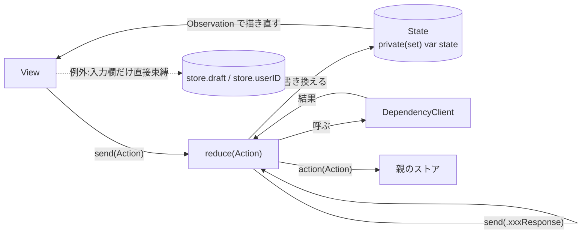

# RillArchitectureSample

<p align="center">

</p>

SwiftUI のアプリのアーキテクチャ **Rill** の見本。

Rill は、[LUCA](https://dev.to/kyome22/luca-a-modern-architecture-for-swiftui-development-3g2i) から着想を得ており、
LUCAのうち `Composable` だけを抜き出し、決まりを 4 つ足した構成。次の 4 つを満たせることを確かめる。

- 状態管理がアーキテクチャとして組み込まれている
- テストしやすい
- 単一方向である
- View 同士の連携(親子間も含む)がしやすい

題材は、読んだ本を記録する小さなアプリ(ログイン、記録する、一覧、詳しい画面)。

名前の Rill は「小さな流れ」のこと。状態が一方向に流れることと、中心が小さい(20 行ほどのプロトコル)ことから。

## 動かし方

```sh
make generate              # project.yml から RillArchitectureSample.xcodeproj を作る(XcodeGen は mint で入れる)
make test                  # アプリのストアと Rill パッケージのテスト(Swift Testing、シミュレーター)
make test-rill             # Rill パッケージのテストだけ(swift test、macOS で手早く)
make check-unidirectional  # 単一方向を破る書き方が、コンパイルエラーになることを確かめる
make check                 # 上の 2 つ
```

`RillArchitectureSample.xcodeproj` を開いて実行すると、ログイン → 記録する → 一覧を触れる。
保存先はメモリの中だけなので、アプリを終えると記録は消える。ユーザー ID に `error` と入れるとログインに失敗する。

動作の確認は Xcode 27.1、iOS 26 のシミュレーターで行った。

## ドキュメント

| ドキュメント | 中身 |
|---|---|
| [構造の図](docs/architecture.md) | 層と依存の向き、1 つの画面の中の流れ、画面とストアの木、親子・兄弟の連携、シートの閉じ方 |
| [4 つの条件をどこで確かめるか](docs/requirements.md) | 条件ごとの決まりと、確かめているテスト・検査。状態の pretty print |
| [UIKit で使う](docs/uikit.md) | SwiftUI との対応、書き方の例、気をつけること |
| [ほかのアーキテクチャとの比較](docs/comparison.md) | Flux との違い、LUCA との違い |

## 全体の流れ

状態を書き換えられるのは `reduce` だけ。View は Action を送り、状態の変化を Observation で受け取って描き直す。
親子の間も Action だけでやり取りする(上へは `action` のクロージャ、下へは `send`)。ほかの図は [構造の図](docs/architecture.md) にある。



## ファイル

| ディレクトリ | 中身 |
|---|---|
| `Packages/Rill/Sources/Rill` | `Composable`(LUCA をもとに `State` を足したもの)、`DependencyClient`、`PrettyPrinter`、シートの Binding の補助 |
| `Packages/Rill/Tests/RillTests` | パッケージのテスト |
| `RillArchitectureSample/Dependencies` | `AppDependencies`、`AuthClient`、`ReadingLogClient` |
| `RillArchitectureSample/Models` | 読書の記録と、入力の確かめ |
| `RillArchitectureSample/Stores` | 画面ごとのストア |
| `RillArchitectureSample/Views` | 画面ごとの View |
| `RillArchitectureSampleTests` | ストアのテスト |
| `Checks` | 単一方向の確かめ |

## 決まり

1. ストアの状態は `State` にまとめ、`private(set) var state` で持つ。外からは書き換えられない。
2. 例外は入力欄の値だけ。書き込みのできる計算プロパティ(`LogForm.draft` など)として出す。
3. 親から子への指示も `await child.send(...)` で行う。
4. `reduce` の中で `Task { }` を作らない。

決まりを破る書き方がコンパイルエラーになることは `make check-unidirectional` で確かめる。
理由と、4 つの条件ごとの確かめ方は [4 つの条件をどこで確かめるか](docs/requirements.md) にある。

## 気づいたこと

- 子の `reduce` の中から `send` すると、親には「結果」の Action が先に、「押した」の Action があとに届く
  (`LogFormTests` の最初のテストで確かめている)。親は「押した」ではなく「結果」で判断する。
- シートを下へのスワイプで閉じたとき、`presentation` は `Task` で Action を送るので、状態が `nil` になるのは一瞬あとになる。
  シミュレーターでの見た目はまだ確かめていない。

## 参考

- [LUCA: A Modern Architecture for SwiftUI Development](https://dev.to/kyome22/luca-a-modern-architecture-for-swiftui-development-3g2i)
- [Kyome22/Telescopure の `Composable.swift`](https://github.com/Kyome22/Telescopure/blob/main/LocalPackage/Sources/Model/Composable.swift)
- [Updating views automatically with observation tracking in UIKit(Apple)](https://developer.apple.com/documentation/uikit/updating-views-automatically-with-observation-tracking-in-uikit)
