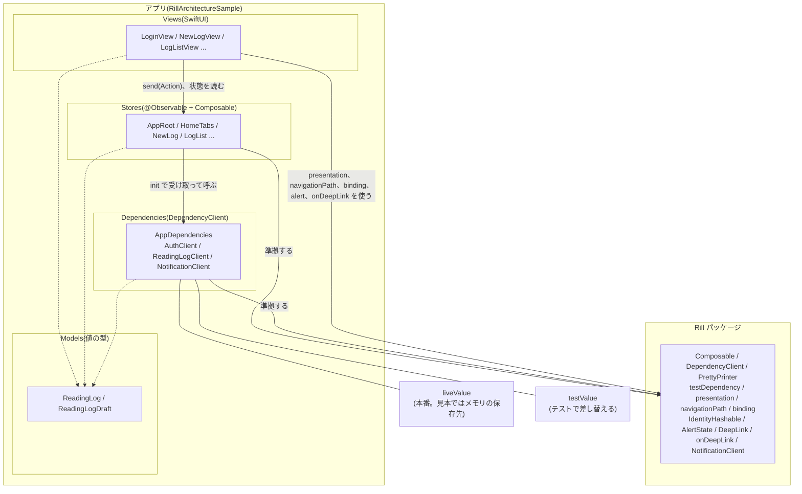
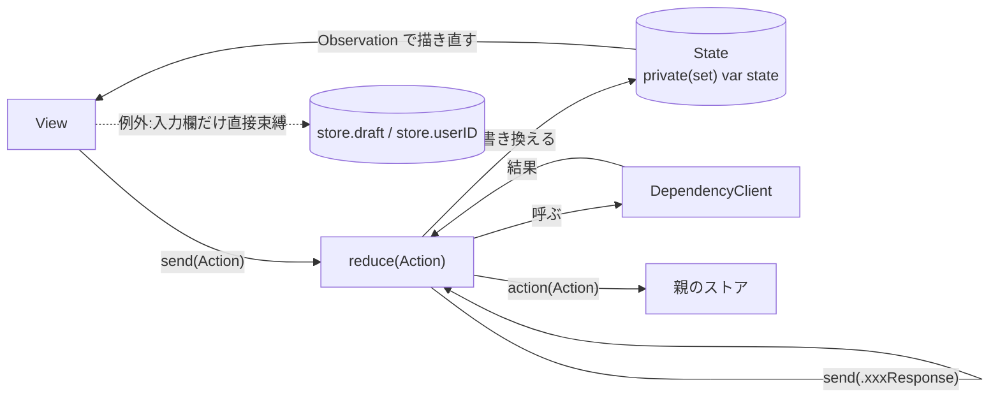
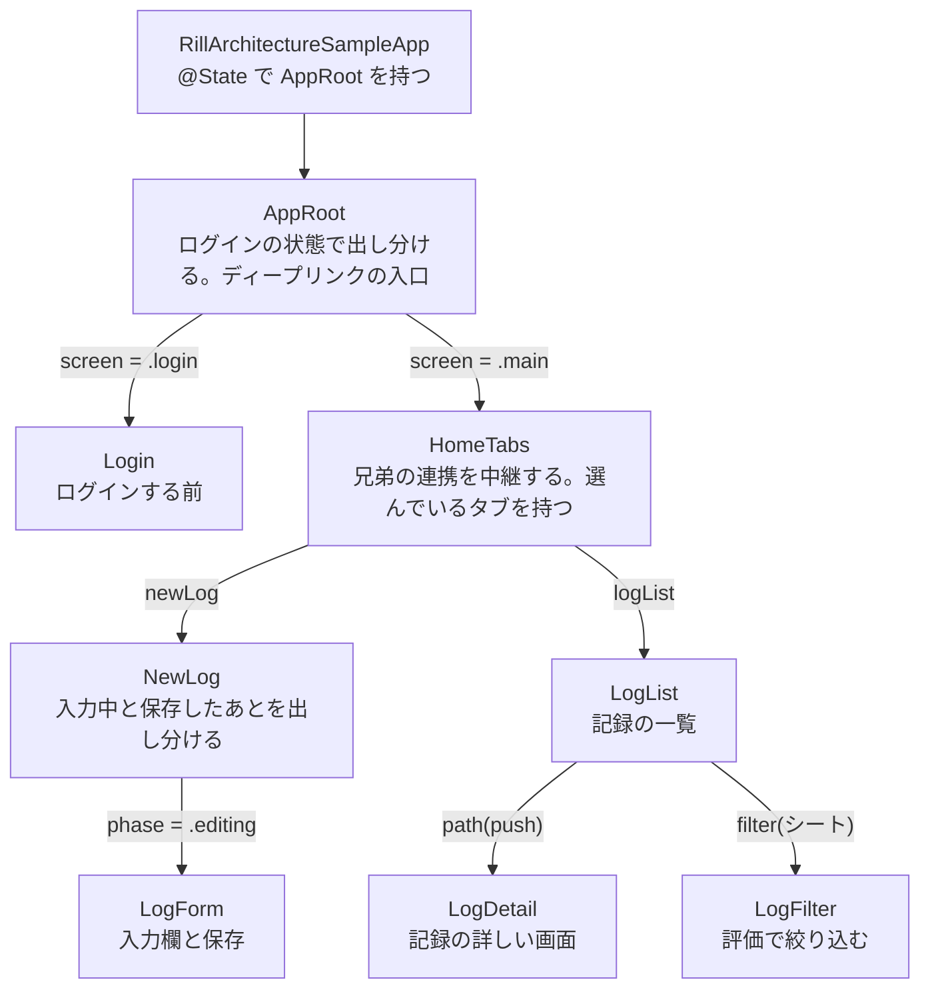
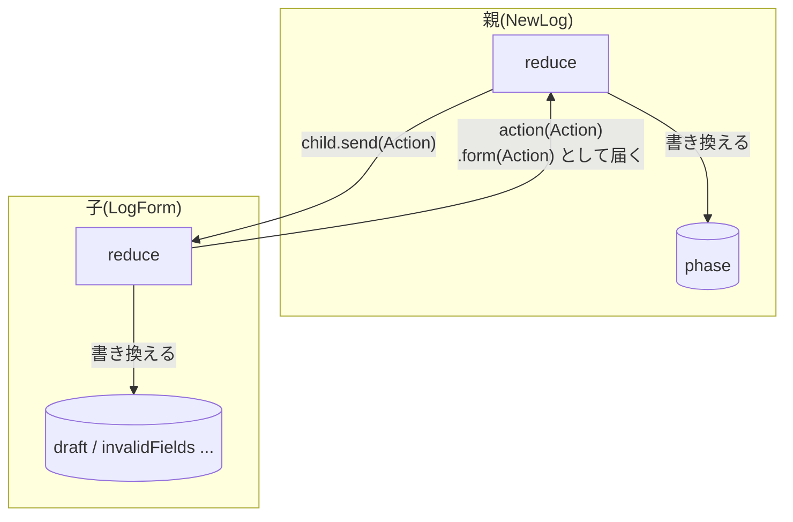
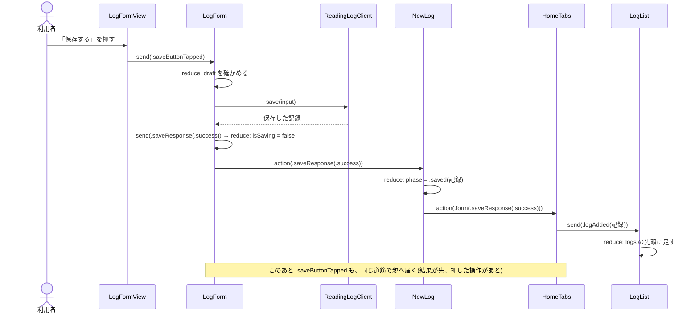
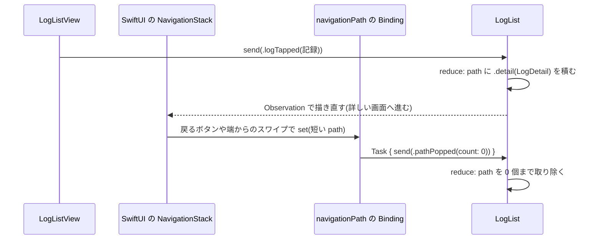
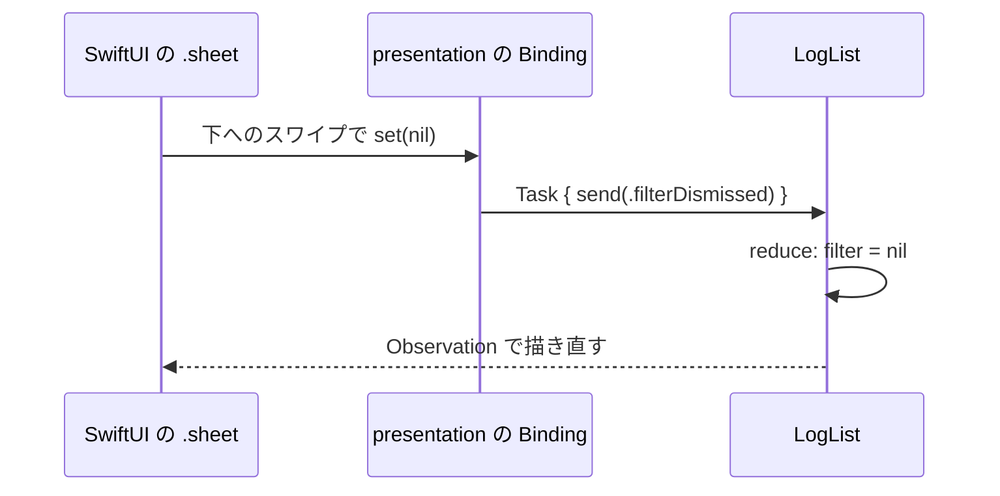

# 構造の図

[README に戻る](../README.md)

## 層と依存の向き

矢印は「使う」向き。View はストアだけを、ストアは依存だけを知る。
ストアと依存の決まり(`Composable`、`DependencyClient`)は、アプリから切り離した `Rill` パッケージに置く。
パッケージはアプリの型を知らない。



## 1 つの画面の中の流れ(単一方向)

状態を書き換えられるのは `reduce` だけ。View は Action を送り、状態の変化を Observation で受け取って描き直す。



## 画面とストアの木

実線は「親が子のストアを持つ」。子の Action は `action` のクロージャで親の `reduce` に届き、親は子へ `send` で指示する。



## 親子の間のやり取り

上へは `action` のクロージャ、下へは `send`。どちらも Action で、相手の状態には触らない。



子を作るときに、親が `action` を渡す。

```swift
LogForm(appDependencies, action: { [weak self] in await self?.send(.form($0)) })
```

## 兄弟の連携:記録を保存すると一覧に足される

記録する画面(孫)の結果が、親の `HomeTabs` で中継されて、一覧の画面(兄弟)へ届く。



## 画面を積む(push)、戻る:戻ったときも Action を通す

積むのは `reduce` だけ。SwiftUI が戻したとき(戻るボタン、端からのスワイプ)は、`navigationPath` の Binding が残った画面の数を Action にして送る。



子(`LogDetail`)で記録を削除したときは、親の `LogList` が `.detail(.deleteResponse(.success))` として受けて、その画面を `path` から取り除く。

## シートを閉じる:スワイプでも Action を通す



評価を選んだときや「キャンセル」のときは、子(`LogFilter`)が `send(.ratingSelected(...))` / `send(.cancelButtonTapped)` し、
親の `LogList` が `.filter(...)` として受けて `filter = nil` にする。

## ディープリンク

URL も、一番上のストアへの Action として受ける。流れの図は [ディープリンク](deeplink.md) にある。

## 通知

NotificationCenter の通知も、`AsyncStream` にしてストアの Action として受ける。流れの図は [通知](notifications.md) にある。
