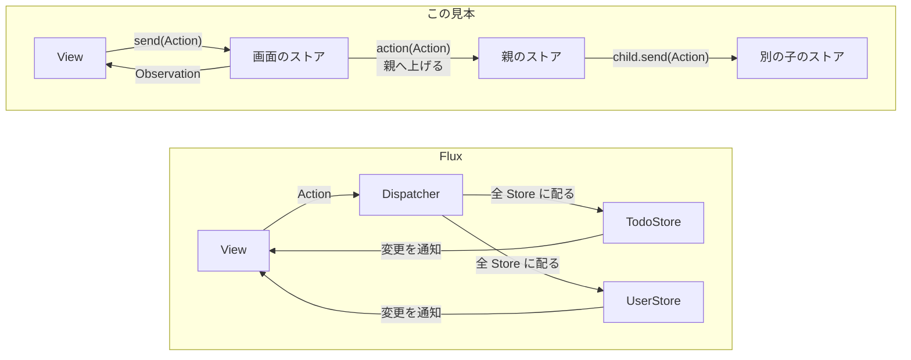

# ほかのアーキテクチャとの比較

[README に戻る](../README.md)

## Flux との違い

Flux と同じく、状態は一方向に流れる。状態を変えるのは Action だけで、書き換えられるのは Store だけ、View は読むだけ。
違いは、Action の届け方と、Store の単位にある。

| | Flux | この見本 |
|---|---|---|
| Action の届け方 | Dispatcher が、すべての Store に配る | View が自分の画面のストアに `send` する。親へは `action` のクロージャで上げる |
| Store の単位 | 扱うデータごと(`TodoStore` など)。画面からは独立していて、アプリに数個 | 画面ごと。親が子を持つ木になる |
| Store 同士の連携 | 同じ Action を、それぞれの Store が受け取る。順番は `waitFor` で決める | 共通の親が子の Action を受け取り、別の子へ `send` する |
| 副作用(通信など) | Action Creator で行い、結果を別の Action として配る | `reduce` の中で依存を呼び、結果を `send(.xxxResponse)` で自分に送る |
| View への反映 | Store の変更の通知を購読する | Observation が、読んだ値を自動で追う |
| 状態の寿命 | Store はアプリと同じだけ生きることが多い | 画面のストアと同じ。画面を閉じれば消える |
| 得意なこと | 複数の画面が同じデータを見る(共有の状態) | 画面ごとに閉じた状態と、親子の連携。テストもストアごとに閉じる |
| 苦手なこと | どの Store がどの Action に反応するか、追いにくくなる | 離れた画面どうしの共有。共通の親まで Action を中継する必要がある |

### Flux の考え方を足すなら

離れた画面どうしで同じデータを見る場面が増えたら、データごとの Store(Flux の Store に近いもの)を 1 つ足し、
`AppDependencies` に入れて各画面のストアへ渡す形が合う。LUCA の `AppStateClient` も同じ考え方。
画面のストアは、その Store を読み書きする「入口」になる。

## LUCA との違い

- LUCA の 3 つのモジュール(UserInterface、Model、DataSource)への分割、`Scene` の層、`AppStateClient` は入れていない(この見本の規模では要らない)。
  切り出したのは、どのアプリでも使える決まり(`Composable`、`DependencyClient`)の `Rill` パッケージだけ。
- 状態を 1 つの `State` の構造体にまとめる(LUCA は、ストアの中にふつうの `var` で並べる)。
  `Composable` の要件にしたので、どのストアでも `state` で読み、`prettyState` で出せる。
- 依存は Environment で配らず、ストアの init で受け取って子へ渡す。
- 子のストアを init の中で作るときは、`weak var parent` を先に捕まえ、最後に `self` を入れる
  (init が終わるまで `[weak self]` を使えないため)。
- モジュールの既定の隔離を MainActor にしたので、`@MainActor` を書かない。

## 参考

- [LUCA: A Modern Architecture for SwiftUI Development](https://dev.to/kyome22/luca-a-modern-architecture-for-swiftui-development-3g2i)
