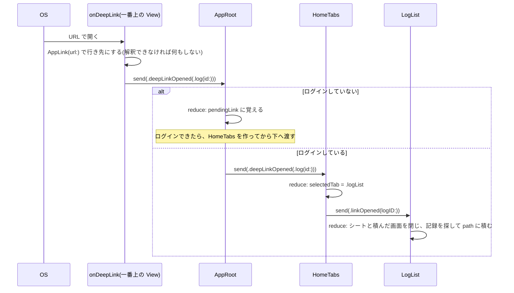

# ディープリンク

[README に戻る](../README.md)

ディープリンクも画面の遷移の 1 つとして、ほかの操作と同じ道筋で扱う。
URL を行き先の値にして一番上のストアへ Action として送り、各ストアが自分の状態を変えてから、残りを子へ `send` で渡す。

## 見本の行き先

| URL | 行き先 |
|---|---|
| `rill-sample://new` | 記録する画面。保存したあとなら新しい入力欄にする。入力中なら、入れた値を消さない |
| `rill-sample://logs` | 一覧の画面。積んだ画面とシートを閉じる |
| `rill-sample://logs/<記録の ID>` | 記録の詳しい画面。一覧の上に、その画面だけを積む。見つからなければ一覧に知らせを出す |

`https://example.com/...` も同じ行き先になる(ユニバーサルリンク)。見本で登録しているのはカスタム URL スキームだけで、
ユニバーサルリンクを使うには Associated Domains の設定が要る。

シミュレーターでは、次のように開ける。

```sh
xcrun simctl openurl booted rill-sample://logs
```

## 流れ



## 何がアーキテクチャで保証されるか

新しい決まりは足していない。ディープリンクは、今の決まりの組み合わせで守られる。

| 保証すること | 仕組み |
|---|---|
| ディープリンクが状態を直接書き換えない | 状態は `private(set)`(決まり 1)。行き先の画面の状態は、外からは作れず、Action を送るしかない。`make check-unidirectional` で、`pendingLink`、`selectedTab`、`linkedLogMissing` を外から書く行がコンパイルエラーになることを確かめている |
| 上から下へ、1 つの道筋で届く | 親から子への指示は `send`(決まり 3)。`AppRoot` → `HomeTabs` → `LogList` の順に、各ストアが自分の分だけ状態を変える |
| 行き先の受け忘れが無い | 行き先は enum(`AppLink`)。受ける `switch` に `default` を書かないので、行き先を足すと、受けていないストアがコンパイルエラーになる |
| 画面がどんな状態でも、同じ結果になる | 行き先は「積んだ画面を足す」ではなく「この状態にする」として書く(`path = [...]`、`filter = nil`)。開いていたシートや積んだ画面に左右されない |
| 準備ができる前に届いても失われない | ログインする前なら `AppRoot` が `pendingLink` に覚え、ログインできたら渡す。読み込む前の記録なら、`LogList` が読み込んでから探す |
| View を立ち上げずに確かめられる | URL の解釈は値の型(`AppLink`)のテスト、行き先への遷移はストアのテストで確かめる。`store.open(url, as:)` で、URL から一番下の画面までを 1 つのテストで通せる |

タブの選択も状態(`HomeTabs.State.selectedTab`)で持つ。ディープリンクでタブを切り替えるには、選んでいるタブが状態に無いといけないため。
タブを押したときも `store.binding(\.state.selectedTab, send: { .tabSelected($0) })` で Action を通す。

## Rill パッケージの補助

| 補助 | すること |
|---|---|
| `DeepLink` | URL を行き先の値にするプロトコル。`init?(url:)` だけを持つ |
| `store.open(_:as:action:)` | URL を行き先にして Action を送る。解釈できない URL なら何もせず false を返す。テストからも使う |
| `View.onDeepLink(_:to:action:)` | `onOpenURL`(カスタム URL スキーム)と `onContinueUserActivity`(ユニバーサルリンク)の両方を受け、`open` を呼ぶ。アプリの一番上の View に付ける |
| `store.binding(_:send:)` | 状態の値を読み、書き込まれたら Action を送る Binding。タブ、`Picker`、`Toggle` など、選ぶ操作に使う(入力欄には使わない) |

```swift
WindowGroup {
    AppRootView(store: store)
        .onDeepLink(AppLink.self, to: store) { .deepLinkOpened($0) }
}
```

## テスト

| テスト | 確かめること |
|---|---|
| `AppLinkTests` | URL を行き先にする。ID の形が違う、知らない行き先、違うスキームやホストは nil |
| `AppRootTests` | ログインしたあとはタブの画面へ渡す。ログインする前は覚えておき、ログインしてから開く。URL から詳しい画面まで開く |
| `HomeTabsTests` | タブを押すと切り替わる。行き先に合わせてタブを選び、子へ渡す |
| `NewLogTests` | 入力中に開かれても、入れた値を消さない |
| `LogListTests` | 読み込む前の記録でも、読み込んでから積む。ほかの画面を開いていても閉じてから積む。見つからなければ知らせる |
| `DeepLinkTests`(Rill) | `open` は解釈できる URL だけを Action にして送る。`binding` は書き込むと Action を送り、`reduce` が状態を変える |

シミュレーターでも、UI テストで次のことを確かめた(この UI テストはリポジトリに含めていない)。

- ログイン画面でリンクを開き、ログインすると一覧のタブが開く。
- 詳しい画面を積んだまま `rill-sample://new` を開くと記録するタブへ、`rill-sample://logs` を開くと、積んだ画面が閉じた一覧へ移る。
- 見つからない ID を開くと、一覧に知らせが出る。
- タブを押しても(Action を通すので反映は一瞬あと)、元のタブに戻ってしまわない。

## UIKit で使うとき

ストアとテストはそのまま使える。URL の受け口だけが変わる。

- `UISceneDelegate` の `scene(_:openURLContexts:)` と `scene(_:continue:)` で URL を受け、
  `Task { await root.open(url, as: AppLink.self) { .deepLinkOpened($0) } }` を呼ぶ。
- タブは `UITabBarControllerDelegate` の `tabBarController(_:shouldSelect:)` で `false` を返して `.tabSelected` を送り、
  `updateProperties()` で `state.selectedTab` を `selectedIndex` に映す。

UIKit の部分は考え方だけで、コードは型検査も動作も確かめていない。
