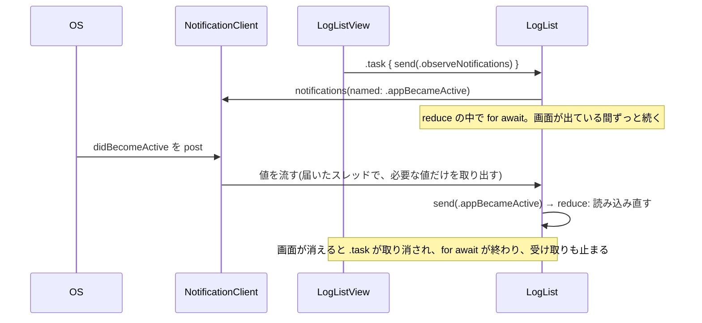

# 通知(NotificationCenter)

[README に戻る](../README.md)

NotificationCenter の通知は、画面の木のつながりと関係なく届く。
Rill では、通知を Swift Concurrency の流れ(`AsyncStream`)にして、ストアの Action として受ける。

## 何に使うか

| 使う | 使わない |
|---|---|
| アプリの外から来る出来事。アプリが前面に来た、時刻やタイムゾーンが変わった、キーボードが出た、ほかのライブラリや、書き換えられない古いコードが知らせた | 画面どうしの連携。ある画面から、離れた別の画面へ知らせる |

画面どうしの連携に通知を使うと、どこから届くかがコードの木から読めなくなる。届く順番や、受ける画面がまだ無いときの扱いも決められない。
Flux の Dispatcher で「どの Store がどの Action に反応するか追いにくい」のと同じことが起きる。

画面どうしは、今までどおり次のどちらかでつなぐ。

- 共通の親が子の Action を受けて、別の子へ `send` する(記録する画面 → `HomeTabs` → 一覧)。
- 離れた画面どうしで同じデータを見るなら、共有のストアを依存として渡す([比較](comparison.md) の「Flux の考え方を足すなら」)。

## 流れ



## 書き方

1. 通知を受けるストアは、依存として `NotificationClient` を受け取る(`AppDependencies.notificationClient`)。
2. 受け始める Action(`.observeNotifications`)を用意し、View の `.task` から送る。
   ほかの読み込み(`.task`)とは分ける。受け取りは画面が消えるまで終わらないので、同じ Action にすると、読み込みが終わったことを親が知れなくなる。
3. `reduce` の中で `for await` し、届くたびに自分へ Action を `send` する。
   `Task { }` は作らない(決まり 4)。取り消しは View の `.task` に任せる。
4. 通知の名前は依存の側で言い換え(`Notification.Name.appBecameActive`)、ストアが UIKit に依存しないようにする。

```swift
case .observeNotifications:
    for await _ in appDependencies.notificationClient.notifications(named: .appBecameActive) {
        await send(.appBecameActive)
    }

case .appBecameActive:
    await send(.task)
```

```swift
// View
.task { await store.send(.task) }
.task { await store.send(.observeNotifications) }
```

通知に値が付いているときは、`notifications(named:transform:)` で、届いたスレッドのうちに必要な値だけを取り出す。
`Notification` は `Sendable` ではないので、そのままストアへは流さない。

```swift
for await height in notificationClient.notifications(named: UIResponder.keyboardWillShowNotification, transform: { notification in
    (notification.userInfo?[UIResponder.keyboardFrameEndUserInfoKey] as? CGRect)?.height
}) {
    await send(.keyboardWillShow(height: height))
}
```

## 何がアーキテクチャで保証されるか

| 保証すること | 仕組み |
|---|---|
| 通知が状態を直接書き換えない | 通知は Action になってから `reduce` に届く。状態は `private(set)`(決まり 1) |
| 画面が消えたら受け取りが止まる | 受け取りは View の `.task` の中で続く。`.task` が取り消されると `for await` が終わり、`NotificationClient` が `removeObserver` する |
| 届いた順に処理される | 通知を送ったスレッドで順に流れに入れ、ストアは 1 つずつ `send` する |
| スレッドをまたいでも安全 | 流れに入れるのは `Sendable` な値だけ。`Notification` そのものはまたがない |
| View を立ち上げずに確かめられる | テストでは `NotificationClient.center(NotificationCenter())` に差し替え、そこへ post する。既定の `testValue` は何も届かない |

## Rill パッケージの補助

| 補助 | すること |
|---|---|
| `NotificationClient` | NotificationCenter の通知を `AsyncStream` にする依存。`liveValue` は `NotificationCenter.default`、`testValue` は何も届かない |
| `NotificationClient.center(_:)` | 指定した NotificationCenter を使う。テストで使う |
| `notifications(named:)` | 通知が届いたことだけを流す |
| `notifications(named:transform:)` | 通知から取り出した値を流す。nil を返した通知は流さない |

## テスト

| テスト | 確かめること |
|---|---|
| `NotificationClientTests`(Rill) | 届いた順に値にして流す。nil になる通知と、ほかの名前の通知は流さない。受けているタスクを取り消すと受け取りを止める。`testValue` は何も届かない |
| `LogListTests` | アプリが前面に来るたびに読み込み直す。受けているタスクを取り消すと `send` が終わり、通知を受けなくなる |

シミュレーターでも、アプリをバックグラウンドへ送って前面に戻すと、本物の `didBecomeActive` がストアまで届き、
受け取りが続いている間もほかの操作(push、シート)が止まらないことを、UI テストで確かめた(この UI テストはリポジトリに含めていない)。

## UIKit で使うとき

ストアはそのまま使える。View の `.task` の代わりに、受け取りの `Task` を ViewController が持ち、画面が消えるときに取り消す。

```swift
private var observing: Task<Void, Never>?

override func viewDidAppear(_ animated: Bool) {
    super.viewDidAppear(animated)
    observing = Task { await store.send(.observeNotifications) }
}

override func viewDidDisappear(_ animated: Bool) {
    super.viewDidDisappear(animated)
    observing?.cancel()
}
```

上のキーボードの例と UIKit の例は、アプリのソースと一緒に型検査が通ることだけを確かめた。動かしてはいない。
